<a href="https://spead.ai"><picture><source media="(prefers-color-scheme: dark)" srcset="docs/readme/banner-dark.svg"></picture></a>

<p align="center"><a href="https://spead.ai"><b>Open spead.ai</b></a> · <a href="#getting-started">Getting started</a> · <a href="https://github.com/nugrahalabib">More of my work</a> · <a href="https://nugrahalabib.com">nugrahalabib.com</a></p>

## Overview

This repository is the public website of Spead AI at spead.ai. It explains the product to companies and institutions in Indonesian and English, publishes a blog and a news room, and sends visitors to a free trial or a sales conversation.

The site is a Next.js 16 app. Landing page copy lives in versioned translation files, while blog posts, news, authors, categories and the link page are edited in a self-hosted Directus 10 CMS, so new articles go live without a deploy. CMS pages refresh every 60 seconds, and a Directus webhook asks search engines to recrawl the sitemap after content changes.

The Spead AI workspace itself is a separate private product. This repository is only the marketing layer in front of it.

<picture><source media="(prefers-color-scheme: dark)" srcset="docs/readme/features-dark.svg"></picture>

## Why it exists

spead.ai is where companies and institutions first meet Spead AI. The site explains the product in Indonesian and English, publishes articles on enterprise AI and company news, and turns interest into a free trial or a sales conversation. It is built so the team can publish new articles and news without a developer or a deploy.

A young AI company needs a public site that looks credible to enterprise and government buyers, speaks Indonesian first, and can grow a steady stream of articles for search engines. Hard-coding every article into the code base would make each post a release.

The answer here is a split: landing copy that rarely changes is versioned in translation files next to the code, while articles, news, authors and categories live in a self-hosted CMS that the team edits directly.

| Who | What they do with it |
| --- | --- |
| **Prospective customer** | Reads what Spead AI does in Indonesian or English, browses articles and news, and starts a free trial or contacts sales. |
| **Content editor** | Writes blog posts and news in the Directus admin, sets categories, authors and featured posts, and sees them on the site within a minute. |
| **Sales team** | Receives demo requests with plan interest, company details and UTM source, stored as records in the CMS. |

<picture><source media="(prefers-color-scheme: dark)" srcset="docs/readme/journey-dark.svg"></picture>

## Tour

### 1. Landing page

One page in five parts: a hero with a short product video, the feature cards, why Spead AI, the plans and a closing call to action. All copy comes from messages/id.json and messages/en.json, so a wording change is a reviewed commit.

- Indonesian is the default locale and English lives under /en
- The language switcher keeps the current page, and a cookie remembers the choice
- Hero video served from the site itself, no third-party player

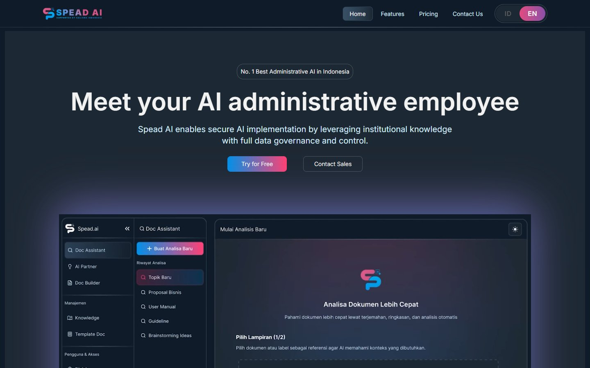

<sub>The English home page with the hero and the product video.</sub>

<p>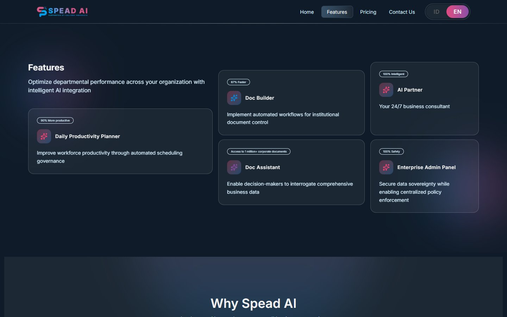 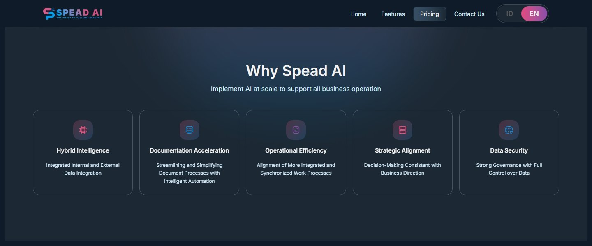</p>

<sub>Left: Feature cards for the product modules. · Right: Why Spead AI, five reasons in one row.</sub>

<p>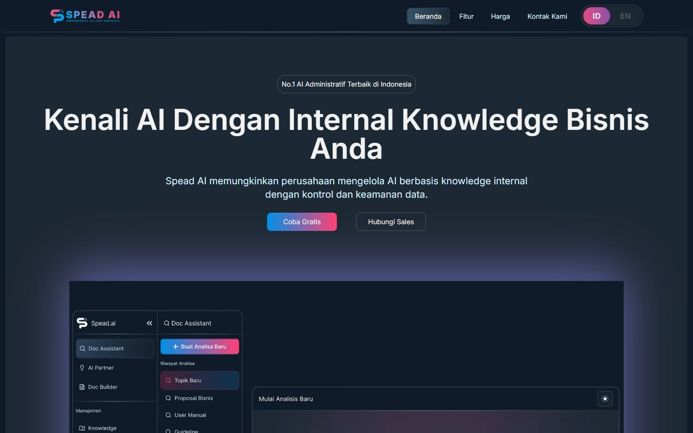</p>

<sub>The same page in Indonesian, the default language.</sub>

### 2. Blog

Articles on enterprise AI written in the CMS. The list shows a highlighted post, category filters and a newsletter sign-up; each article renders Markdown with an executive summary box and JSON-LD for search engines.

- Blogs, categories and authors are Directus collections
- Pages revalidate every 60 seconds
- Built-in sample posts appear when the CMS cannot be reached, so the page never breaks

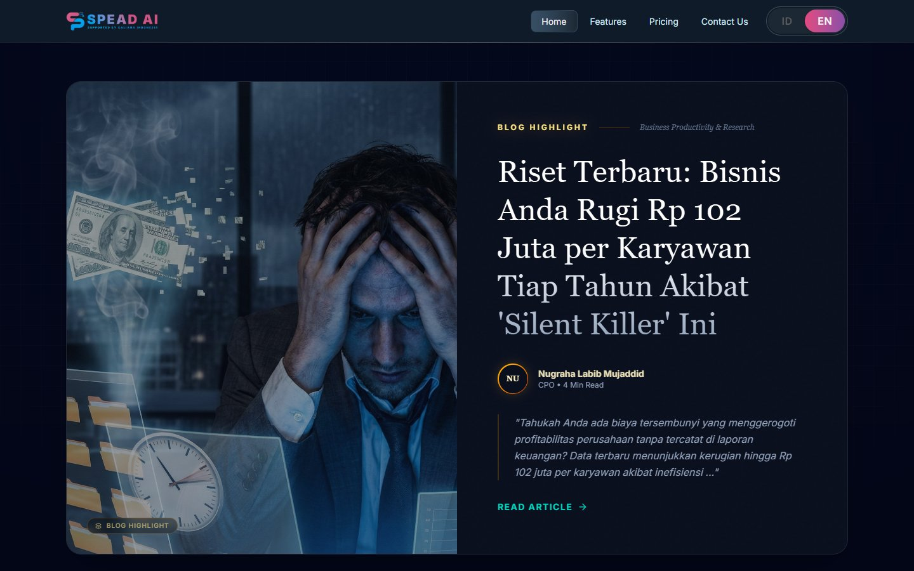

<sub>The blog with its highlighted article.</sub>

<p>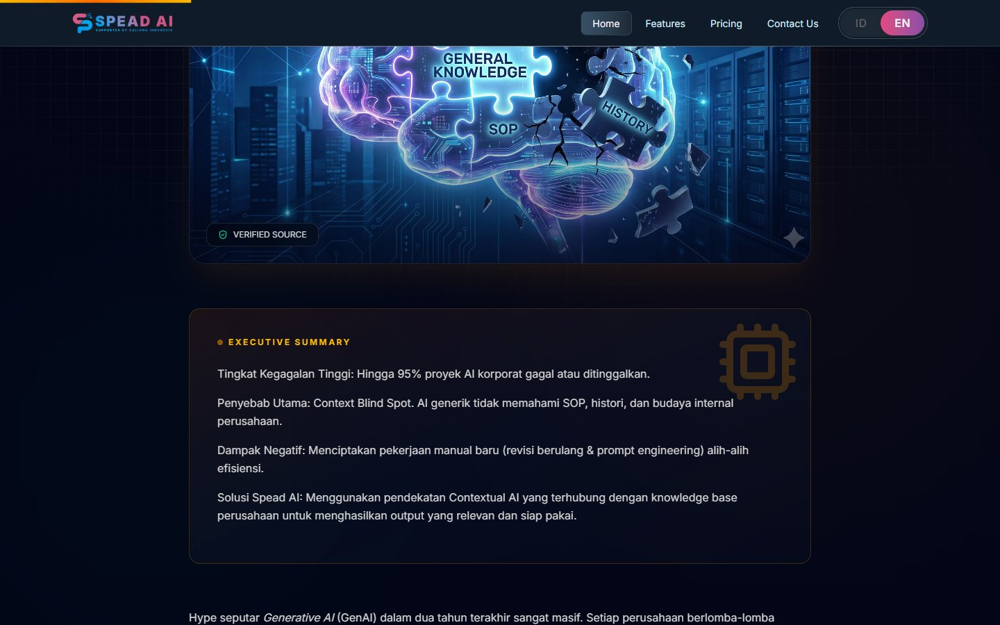</p>

<sub>An article with its executive summary box.</sub>

### 3. News room

Company news in one feed: press releases, product launches and events, with search, type filters and a year filter, and a full page per story.

- Posts and categories are Directus collections, only published items are shown
- Each story page builds its own metadata and JSON-LD

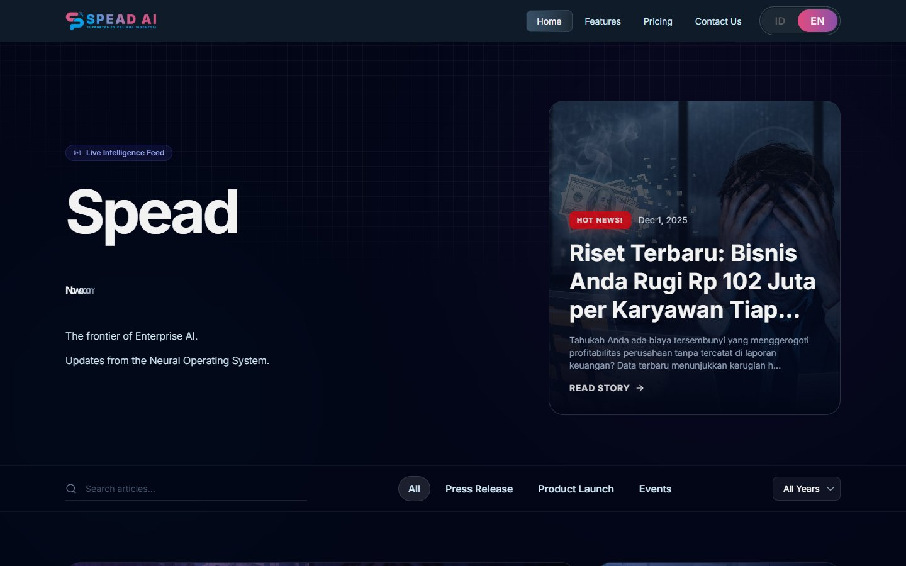

<sub>The news room with the featured story and filters.</sub>

<p>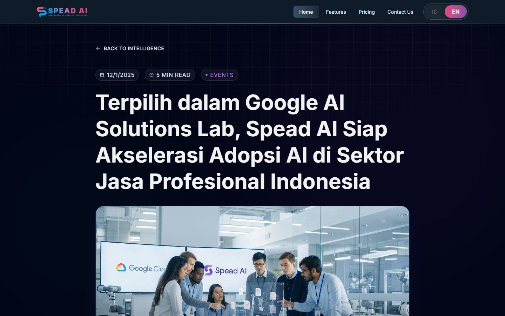</p>

<sub>A news story page.</sub>

### 4. On a phone

The same layout collapses into a single column with a menu button and the language toggle kept in reach.

- Tailwind CSS 4 responsive layout
- Same content and routes as desktop

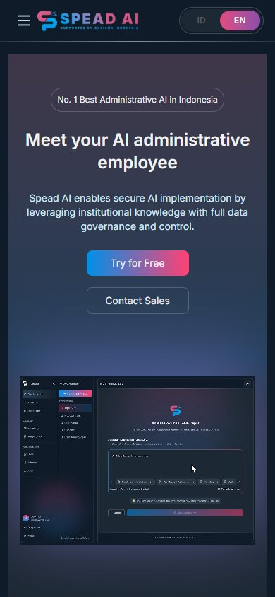

<sub>The home page at phone width.</sub>

## How it is built

The site is a Next.js 16 App Router project with next-intl for routing and translations. Pages live under src/app/[locale], and a proxy file handles the locale prefix. The home page is built from five components in src/components/homepage that read only from the translation files.

Dynamic content comes from Directus 10.10 over REST through the Directus SDK. Blog, news and link pages use incremental static regeneration with a 60 second window. Three route handlers sit next to the pages: /api/booking validates and stores demo requests in the CMS, /api/newsletter stores sign-ups, and /api/reindex accepts a Directus webhook with a shared secret header and pings search engines with the sitemap.

Production runs as two containers from docker-compose.prod.yml: the standalone Next.js server built by a multi-stage Node 20 Alpine Dockerfile, and Directus with SQLite and an uploads folder, joined by a private network and fronted by a reverse proxy.

<picture><source media="(prefers-color-scheme: dark)" srcset="docs/readme/architecture-dark.svg">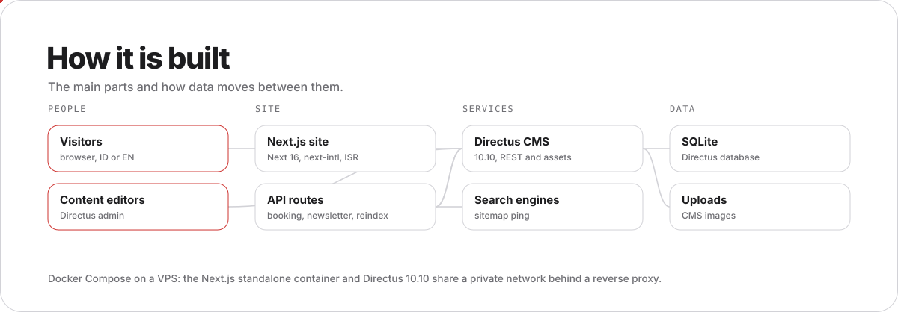</picture>

### Security

- Directus key, secret and admin password are read from environment variables; the CMS database is ignored by git.
- The reindex webhook rejects requests without the shared secret header.
- The booking endpoint validates required fields and email format before writing to the CMS.
- The site container runs as a non-root user.

### Decisions

| Decision | Why |
| --- | --- |
| Landing copy in translation files | Copy that rarely changes stays reviewable in git and loads without a CMS round trip. |
| Articles and news in Directus | The team publishes without a developer or a deploy, and the site picks changes up within a minute. |
| SQLite inside Directus | One small site does not need a separate database server; the file and uploads sit on a volume. |
| Sample posts as a fallback | Blog and news pages still render during CMS downtime or local work without the CMS. |

<picture><source media="(prefers-color-scheme: dark)" srcset="docs/readme/stack-dark.svg">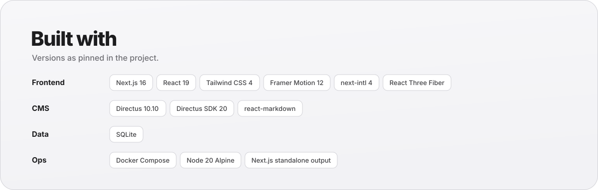</picture>

### Highlights

- Content is split by how often it changes: landing copy is versioned in translation files, articles and news live in the CMS.
- CMS pages use incremental static regeneration with a 60 second window, so new posts appear without a rebuild.
- The reindex webhook only runs when the request carries the shared secret header, then pings search engines with the sitemap.
- The production image is a multi-stage build of the standalone output that runs as a non-root user.
- Directus keys and the admin password are read from environment variables, and the CMS database is not tracked in git.

## Getting started

The site has two parts: the Next.js app in the repository root and a Directus 10.10 CMS that runs in Docker.
The landing page renders from the translation files alone, so you can work on it without the CMS.

## Requirements

- Node.js 20 or newer (the Docker image uses `node:20-alpine`; Next.js 16 needs Node 20)
- Docker with Compose, only for the CMS

## 1. Run the site

```bash
npm install
npm run dev          # http://localhost:3000, redirects to /id; English is at /en
```

Create a `.env` file in the root first (the names are below). Without a reachable CMS the home page still renders in
both languages from `messages/id.json` and `messages/en.json`, and the blog and news pages fall back to the sample posts
in `src/lib/mock-news.ts`.

## 2. Run the CMS (optional)

```bash
docker compose up -d   # Directus 10.10 on http://localhost:8055
```

`docker-compose.yml` reads `DIRECTUS_KEY`, `DIRECTUS_SECRET` and `DIRECTUS_ADMIN_PASSWORD` from the `.env` file in the
root. The admin email is set in the compose file. The SQLite database is created at `directus/database/data.db` on the
first start and is not tracked in git, so a new CMS starts empty. The site reads these collections: `global_settings`,
`blogs`, `blog_categories`, `blog_page_settings`, `posts`, `categories`, `news_page_settings`, `bio_settings`,
`bio_categories`, `bio_links`, `bookings` and `newsletter_subscribers`. There is no single schema export; the helper
scripts used while building the schema are in `scripts/`.

## Environment variables

| Name | Used by | Purpose |
| --- | --- | --- |
| `NEXT_PUBLIC_DIRECTUS_URL` | site | CMS address, for example `http://localhost:8055` |
| `NEXT_PUBLIC_BASE_URL` | site | Public site address for the sitemap, metadata and the reindex ping |
| `DIRECTUS_WEBHOOK_SECRET` | site | Shared secret that `/api/reindex` expects in the `x-webhook-secret` header |
| `DIRECTUS_KEY`, `DIRECTUS_SECRET` | CMS | Directus instance key and secret, any long random strings |
| `DIRECTUS_ADMIN_PASSWORD` | CMS | Password of the first Directus admin |
| `DIRECTUS_ADMIN_EMAIL` | CMS, production compose only | Email of the first Directus admin |

`env.example` and `env.template` list the same names. Never commit the `.env` file.

## Scripts

| Command | What it does |
| --- | --- |
| `npm run dev` | Development server on port 3000 |
| `npm run build` | Production build (standalone output) |
| `npm run build:prod` | Same build with `NEXT_IGNORE_TYPE_CHECK=true`; POSIX shell syntax, so use WSL or Git Bash on Windows |
| `npm run start` | Serve the production build |
| `npm run lint` | ESLint |

Note: `next.config.ts` sets `typescript.ignoreBuildErrors`, so type errors do not stop a build. Run `npx tsc --noEmit`
when you want a type check.

## Production with Docker

```bash
docker compose -f docker-compose.prod.yml up -d --build
```

This builds the site image (multi-stage `node:20-alpine`, standalone output, non-root user) and starts it next to
Directus on a private network. The compose file reads `DIRECTUS_KEY`, `DIRECTUS_SECRET`, `DIRECTUS_ADMIN_EMAIL`,
`DIRECTUS_ADMIN_PASSWORD` and `DIRECTUS_WEBHOOK_SECRET` from `.env`. The Dockerfile bakes `NEXT_PUBLIC_BASE_URL` and
`NEXT_PUBLIC_DIRECTUS_URL` in at build time; pass `--build-arg` values to deploy under other domains, and add your CMS
host to `images.remotePatterns` in `next.config.ts`. A reverse proxy in front terminates HTTPS; its config is not in
this repository.

## What was verified

On 26 November 2026 the steps in section 1 were run on a clean copy: `npm ci`, then `next dev` with
`NEXT_PUBLIC_DIRECTUS_URL` pointing at an address with no CMS. `/id` and `/en` rendered the landing page, and `/en/blog`
and `/en/news` rendered the sample posts. The CMS and the production compose file were read, not run.

Corrections to the previous README: the app is on Next.js 16 (not 15) and needs Node.js 20; `DIRECTUS_STATIC_TOKEN` is
not read anywhere in the code; Directus credentials come from `.env` and are no longer written in the compose file.

## Project structure

```text
.
├── src/
│   ├── app/[locale]/        home, blog, news, booking and linkbio pages (id and en)
│   ├── app/api/             booking, newsletter and reindex route handlers
│   ├── app/sitemap.ts       sitemap and robots rules
│   ├── components/homepage/ the five landing sections
│   ├── components/          layout, article rendering, JSON-LD, language switcher
│   ├── i18n/                next-intl routing (id default, en)
│   └── lib/                 Directus client and sample posts
├── messages/                id.json and en.json, all landing page copy
├── public/                  logo, hero video, icons
├── directus/uploads/        CMS image files
├── scripts/                 helper scripts used to shape the Directus schema
├── Dockerfile               production image of the site
├── docker-compose.yml       Directus for local work
└── docker-compose.prod.yml  site and Directus for production
```

Older landing sections from an earlier home page design remain in `src/components/sections` and
`src/components/SilentKiller`; the current home page does not import them.

## License

All rights reserved. See [LICENSE](LICENSE). Logos and marks belong to their owners.

---

<sub>Made by [Nugraha Labib Mujaddid](https://github.com/nugrahalabib) · [nugrahalabib.com](https://nugrahalabib.com) · [nugrahalabib@gmail.com](mailto:nugrahalabib@gmail.com)</sub>
